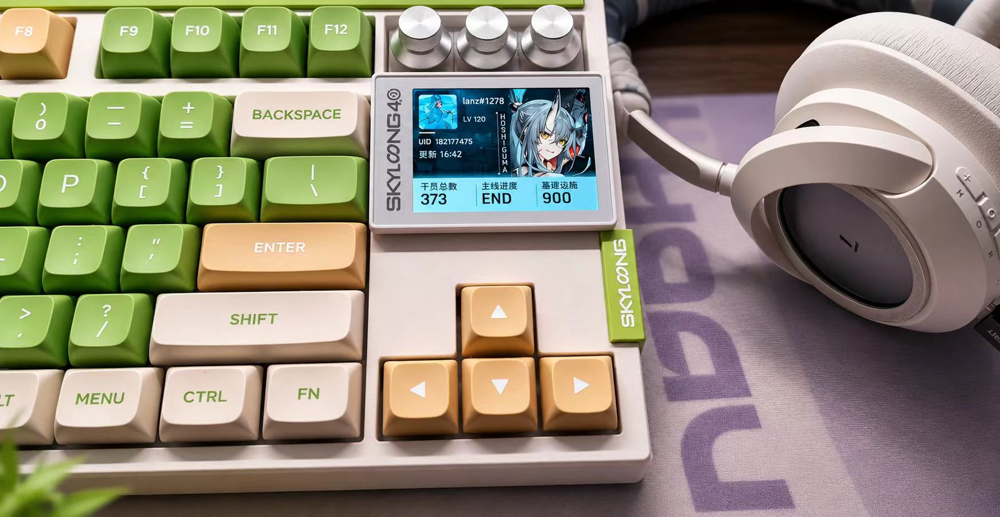
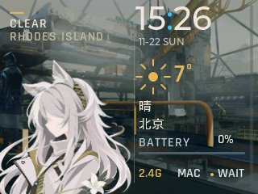
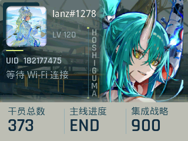
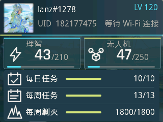
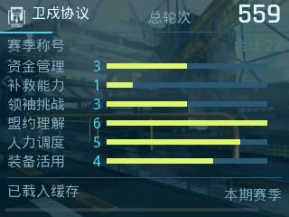
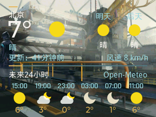
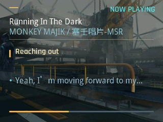

# Arknights Keyboard Screen · 明日方舟键盘副屏

把 **SKYLOONG GK87 / GK4 机械键盘的 320×240 副屏**改造成一块「明日方舟面板」：
森空岛扫码登录后，直接显示你的博士档案、每日理智、卫戍协议战绩与赛季称号，
背景随**天气与时间**自动切换成游戏内的首页场景。

> 本项目基于 **JZ-Skyloong/esp32_screen_module** 二次开发。
> 上游固件（屏幕驱动、键盘协议、天气、音乐、Web 配网等）沿用 Skyloong 的授权条款，
> 详见 [README-UPSTREAM.md](README-UPSTREAM.md)。二次开发新增部分为 MIT，见 [LICENSE](LICENSE)。


**按键**：`Fn + ~` 切换页面；**长按** `Fn + Menu` 进入 / 退出设置页。



> 上图是键盘实拍；**照片本身做过调色处理**（提亮、加冷调），屏幕内容与真机一致。

---

## 界面

以下全部是设备**真实截图**（固件直接导出，非渲染图）：

| 首页 | 博士档案 |
| --- | --- |
|  |  |

| 每日数据 | 卫戍协议 · 称号看板 |
| --- | --- |
|  |  |

| 天气 | 音乐 |
| --- | --- |
|  |  |

| 设置 |
| --- |
|  |

---

## 文档

| 文档 | 内容 |
| --- | --- |
| **[使用教程](docs/USAGE.md)** | 按键速查、配网、扫码登录、日常使用、Web 图库怎么用、常见问题 |
| **[功能说明](docs/FEATURES.md)** | 每个页面的实际行为，**背景按时间 + 天气切换的完整规则**、刷新节奏、存储布局 |
| **[烧录指南](docs/FLASHING.md)** | 从零装 ESP-IDF 5.1.4 到烧进设备，含自动脚本与全部常见报错 |
| **[网易云歌词插件](pc-companion/README_zh.md)** | BetterNCM 插件：把「正在播放」推到副屏，安装条件与原理 |

---

## 功能

### 🖼️ 首页场景背景系统（核心）
- 六套场景随状态自动切换：
  - **白天**（6:00–17:00）按天气选 **晴朗 / 多云 / 雨天 / 降雪**
  - **黄昏**（17:00–20:00、5:00–6:00）→ 黄昏场景
  - **夜间**（20:00–5:00）→ 夜景
  - 优先级：夜间 > 黄昏 > 天气
- 素材取自 [PRTS 明日方舟维基 · 首页场景一览](https://prts.wiki/w/首页场景一览)，为游戏内官方首页场景
- 主页、天气、音乐、博士档案、卫戍协议、登录、设置、配网页**共用同一套背景层**，每页用不同的压暗层保证白字可读
- 完整规则见 [功能说明](docs/FEATURES.md#2-背景系统按时间--天气切换)

### 🎓 博士档案页
- 圆角头像、玩家名、等级、UID、最后同步时间
- 助理干员立绘：自动从森空岛取当前助理，左缘轻微渐隐融入背景
- 助理**英文名竖排**贴靠角色左侧（超过 10 个字母自动改横排）
- 底部信息条：干员总数 / 主线进度 / 集成战略

### 📋 每日数据页
- 理智、无人机（带进度条与上限）
- 每日任务、每周任务、每周剿灭完成度

### 🛡️ 卫戍协议页
- 两个看板每 9 秒自动交替：
  - **战绩看板**：场次 / 胜率（含胜率条）/ 最高奖杯 / 最高轮次 + 总轮次、近 20 场胜负色带、场均轮次、连胜
  - **称号看板**：资金管理 / 补救能力 / 领袖挑战 / 盟约理解 / 人力调度 / 装备活用 六维条形图
- 称号数据来自 `garrison/info` 接口（需 `x-transformed: base64` 请求头），解析时直接从
  base64 内容里截取 `titleTypeCnt` 小对象，避免把整季数据塞进内存

### 🎵 音乐页（网易云歌词同步）
- 电脑端 BetterNCM 插件把网易云「正在播放」推过来，副屏显示：歌名、歌手、**当前歌词 + 下一句**、进度条
- 开始播放自动切到音乐页，暂停保留曲目信息，停止退回原页面
- 歌词带 400 ms 提前量、进度用 `performance.now()` 补毫秒（DOM 只有整秒）
- 插件在 `pc-companion/`，**在副屏上不用做任何操作**，装好插件、填一次屏幕地址即可
- 上手步骤见 [4.1 音乐页与歌词同步](docs/USAGE.md#41-音乐页与歌词同步可选)，协议与字段见 [功能说明](docs/FEATURES.md#72-音乐页)

### 🌤️ Web 图库（自定义素材）
- 浏览器打开 `http://<设备IP>/art`
- 6 个背景槽位（晴 / 多云 / 雨 / 雪 / 黄昏 / 夜）+ 1 个主页左侧图槽位
- **在网页里就能裁切**：拖动平移 + 缩放滑杆，导出精确 320×240 / 176×226 的 PNG
- 透明 PNG 完整保留 alpha；主页图可调水平/垂直/大小
- 实时预览：直接生成「主界面效果图」，所见即所得
- 只替换你上传的那个槽位，其余继续用官方场景

### 🔑 森空岛扫码登录
- 页面内显示二维码，森空岛 App 扫码即可
- 凭证存于设备 NVS，自动续期；冷启动可用账号 token 静默恢复

### ⚡ 切页永不卡顿
所有网络请求都在独立 FreeRTOS 任务里跑，**任何页面的数据没到手都能立刻切页**。

---

## 快速开始

### 1. 硬件

- SKYLOONG **GK87 / GK4** 键盘副屏模块（ESP32-S3，16MB Flash，320×240 ST7789）
- USB-C **数据线**（不是纯充电线）

### 2. 烧固件（三条路，选最省事的一条）

| 方式 | 你需要 | 怎么做 |
| --- | --- | --- |
| **① 网页刷机**（推荐给普通用户） | Chrome / Edge 桌面版 | 打开 **<https://lenz2023.github.io/ArknightsKeyboardScreen/flasher/>** → CONNECT → 选串口 → 等完成 |
| **② 一键脚本**（不需要 ESP-IDF） | Python 3 | `.\tools\flash-noidf.ps1`（Windows） / `./tools/flash-noidf.sh`（macOS/Linux），会自动装 esptool 并烧 `docs/flasher/firmware/` 里的四个镜像 |
| **③ 自己编译** | ESP-IDF 5.1.4 | 见下面[第 3 节](#3-编译并烧录需要-esp-idf) |

网页刷机页托管在 GitHub Pages（源码是仓库里的 [`docs/flasher/`](docs/flasher/)），也可以在自己机器上跑：
`cd docs/flasher && python -m http.server 8000` 后打开 `http://localhost:8000`（浏览器要求 https 或 localhost 才能用串口，直接双击 html 不行）。

网页刷机和脚本烧的是 `docs/flasher/firmware/` 里的四个镜像（bootloader / 分区表 / otadata / 应用），
分别写到 `0x0`、`0x8000`、`0x10000`、`0x20000`——**故意不合成单文件**：分段镜像会在 `0x8C00~0x10000`
的空隙填 `0xFF`，把 NVS（WiFi、账号、自定义背景）一起抹掉。

> ⚠️ 键盘闲置约 10 分钟会自动熄屏，休眠时 USB 会断开 —— **先按一下键唤醒**再烧录。

三种方式的完整说明、常见报错见 **[烧录指南](docs/FLASHING.md)**。

### 3. 编译并烧录（需要 ESP-IDF）

需要 **ESP-IDF 5.1.4**。装法（官方安装器 / 命令行 / 国内镜像 / 多 Python 的坑）全部写在
**[烧录指南](docs/FLASHING.md)** 里。简要版：

```bash
# macOS / Linux
export IDF_PATH=~/esp/esp-idf-v5.1.4
. "$IDF_PATH/export.sh"

# Windows PowerShell
$env:IDF_PATH = "D:\esp\esp-idf-v5.1.4"
. "$env:IDF_PATH\export.ps1"
```

```powershell
# Windows：自动找串口 → 编译 → 烧录
.\tools\flash.ps1
.\tools\flash.ps1 -Monitor      # 烧完顺便看日志
```

```bash
# macOS / Linux
./tools/flash.sh
./tools/flash.sh -m
```

脚本会自动跳过蓝牙串口、优先选 Espressif 设备。手动版：

```bash
idf.py build
idf.py -p COM7 -b 460800 flash     # macOS / Linux 换成 /dev/cu.usbmodem* 或 /dev/ttyACM0
```

> 从上游旧版本切过来时先跑一次 `idf.py reconfigure`（`main/CMakeLists.txt` 用 `file(GLOB ...)`）。

### 4. 配网与登录

1. 开机进配网页，手机连设备热点，网页里填 WiFi
2. 长按 `Fn+Menu` → 设置 → **启动 Web 服务器**，记下屏幕上的 IP
3. `Fn+~` 切到 **森空岛登录** 页，用森空岛 App 扫码
4. 回到博士档案 / 卫戍协议页，数据自动拉取

详细的操作步骤、图库用法、常见问题都在 **[使用教程](docs/USAGE.md)**。

---

## 项目结构

```
.
├── main/
│   ├── main.cpp / hal.cpp            入口、HAL、Web 服务器与 /art 图库
│   ├── SklandApi.cpp                 森空岛 API 客户端（签名 / 鉴权 / 拉取）
│   ├── ArtStore.cpp                  用户自定义图片存储（LittleFS）
│   ├── scene_home_bg.c               首页场景图资源（6 张 320×240 RGB565）
│   ├── apps/
│   │   ├── home.cpp                  主页（含天气/时间背景）
│   │   ├── Weather.cpp               天气页 + Atmosphere 背景层实现
│   │   ├── Music.cpp                 音乐页
│   │   ├── SklandLogin.cpp           森空岛扫码登录
│   │   ├── SklandGeneral.cpp         博士档案 / 每日数据
│   │   ├── SklandGarrison.cpp        卫戍协议
│   │   ├── settings.cpp / qrcode.cpp 设置 / 配网
│   │   └── *.inc                     干员名表、图标与徽记等资源
│   └── include/
│       ├── ArtStore.h  Atmosphere.h  SklandApi.h
│       └── ...                       上游原有头文件
├── docs/                             使用 / 功能 / 烧录文档与截图
├── tools/                            场景图生成、徽记生成、一键烧录脚本
├── components/                       Arduino / LVGL / TFT_eSPI / esp_littlefs 等
├── ui-design/                        设计稿与素材（含历史版本）
├── web/                              设备内置 Web 前端（图片、JS）
├── pc-companion/                     BetterNCM 插件：网易云歌词投屏到副屏
├── README-UPSTREAM.md                上游原始 README 与 Skyloong 授权声明
├── LICENSE                           二次开发部分 MIT
└── LICENSE-THIRD-PARTY.md            第三方组件许可证清单
```

`tools/` 里还有几个可复用的脚本：

| 脚本 | 用途 |
| --- | --- |
| `flash.ps1` / `flash.sh` | 自动搜索串口并编译烧录 |
| `gen_scene_bg.py` | 从 `tools/scene-src/` 的原始 PNG 生成 `main/scene_home_bg.c`（换背景图时用） |
| `verify_scene_bg.py` | 反向解析 `.c` 还原 PNG，校验资源字节 |
| `gen_garrison_emblem.py` | 从 PRTS 徽记生成 `GarrisonEmblem.inc` |

---

## 实现要点

### 数据获取不阻塞界面
LVGL 的 App 循环在持有互斥锁的情况下运行，任何同步 HTTP 都会顶住整个切换流程。
因此森空岛相关页面**全部改为 FreeRTOS worker 异步取数**：

- `SklandGarrison` / `SklandGeneral` / `SklandLogin` / 配网页各有一个专用网络任务
- 主线程只做「到期投递请求」与「取回结果刷 UI」
- 用 `portMUX` + 单调递增的 `generation` 计数器防止销毁期间的竞态
- 天气页、音乐页改为只读后台已取好的数据，自身不发请求

### 背景层（Atmosphere）
`main/include/Atmosphere.h` 暴露四个函数，各页在 `setup()` 挂载、`loop()` 刷新、`destroy()` 卸载：

```c
void atmosphereAttach(lv_obj_t *screen, uint32_t veilColor, uint8_t veilOpa);
void atmosphereRefresh(void);              // 只在天气/时段/图片变化时真正换图
void atmosphereDetach(void);
const char *atmosphereSceneLabel(void);    // CLEAR / CLOUDY / RAIN / SNOW / DUSK / NIGHT
```

实现放在 `Weather.cpp`（`main/CMakeLists.txt` 用 `file(GLOB ...)`，新增 `.cpp` 需要 reconfigure）。
每页传入不同的 `veilOpa` 控制压暗程度。自定义背景只保留当前屏需要的那一张，
六槽共用一个 PSRAM 缓冲，避免 6×150KB 常驻内存。

### 卫戍称号的解析
`garrison/info` 返回的 `data.content` 是一整季数据的 base64（400KB+），
直接 base64 解码 + `cJSON_Parse` 会把内部 RAM 吃光导致 WiFi 定时器申请失败而崩溃。
因此改为：在原始 body 里定位 `"content"` → 只解码出字符串 → `strstr` 找到 `"titleTypeCnt"`
→ 花括号配平截出那个小对象 → 只对它做 `cJSON_ParseWithLength`。

### 图片上传
浏览器端用 canvas 完成裁切与缩放，导出尺寸精确的 PNG，再由设备端 lodepng 解码、
转成 LVGL 的 `TRUE_COLOR` / `TRUE_COLOR_ALPHA` 描述符存入 LittleFS。

---

## 已知限制

- 森空岛接口未公开，字段可能随版本变化；本项目对缺字段做了降级显示，但无法保证长期兼容
- 卫戍协议 `history-log` 在部分账号/赛季只返回 `completeState` / `trophyAfter` / `passRound`，
  因此**击杀数、难度、模式、对局时间无法显示**
- 图库上传需要电脑与设备在同一局域网（校园网/公司网常隔离设备）
- 素材版权归鹰角网络所有，仅供个人非商业使用

---

## 致谢

- 上游固件：[JZ-Skyloong/esp32_screen_module](https://github.com/JZ-Skyloong/esp32_screen_module)
- 森空岛接口与数据字段参考：[gxy12345/arknights-plugin](https://github.com/gxy12345/arknights-plugin)
- 首页场景素材：[PRTS 明日方舟维基](https://prts.wiki/w/首页场景一览)
- 干员英文名数据：明日方舟游戏 `character_table.json`（`appellation` 字段）
- [LVGL](https://lvgl.io/) / [TFT_eSPI](https://github.com/Bodmer/TFT_eSPI) / [Arduino-ESP32](https://github.com/espressif/arduino-esp32)

---

## 许可证

- **二次开发新增代码**（森空岛集成、卫戍协议、博士档案、首页场景背景、图库与 Web 上传等）：[MIT](LICENSE)
- **上游固件**：遵循 Skyloong 的开发文档授权条款，商业用途需向 Skyloong 申请授权，
  详见 [README-UPSTREAM.md](README-UPSTREAM.md)
- **第三方组件**：各自保留原许可证，详见 [LICENSE-THIRD-PARTY.md](LICENSE-THIRD-PARTY.md)
- **游戏素材**：著作权归 HYPERGRYPH（鹰角网络），本仓库仅作个人学习用途
