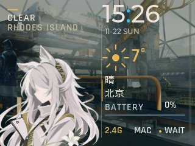
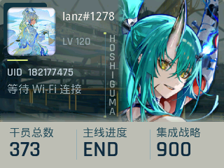
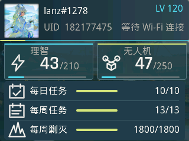
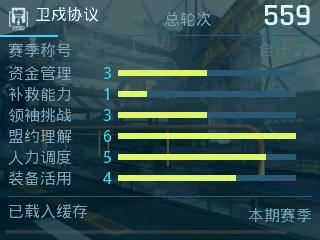
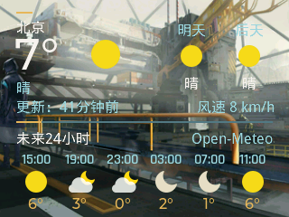
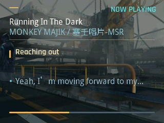

# 功能说明

本文按页面与子系统逐一说明**实际行为**（不是规划），其中「背景切换规则」是本项目的核心逻辑，写得最细。

> 截图全部是设备真实画面，由固件导出（`docs/screenshots/`）。

---

## 目录

- [1. 页面总览](#1-页面总览)
- [2. 背景系统：按时间 + 天气切换](#2-背景系统按时间--天气切换)
- [3. 博士档案页](#3-博士档案页)
- [4. 每日数据页](#4-每日数据页)
- [5. 卫戍协议页](#5-卫戍协议页)
- [6. 首页（天气时钟）页](#6-首页天气时钟页)
- [7. 天气页 / 音乐页](#7-天气页--音乐页)
- [8. 森空岛登录](#8-森空岛登录)
- [9. 设置页与配网页](#9-设置页与配网页)
- [10. Web 服务与图库](#10-web-服务与图库)
- [11. 数据刷新节奏一览](#11-数据刷新节奏一览)
- [12. 存储布局](#12-存储布局)
- [13. 已知限制](#13-已知限制)

---

## 1. 页面总览

| 页面 | 内容 | 截图 |
| --- | --- | --- |
| 首页 | 时间、日期、天气、电量、网络状态、主页左侧自定义立绘图 |  |
| 博士档案 | 头像 / 玩家名 / 等级 / UID / 助理立绘与竖排英文名 / 干员总数·主线进度·集成战略 |  |
| 每日数据 | 理智、无人机、每日任务、每周任务、每周剿灭 |  |
| 卫戍协议 · 战绩看板 | 场次、胜率、最高奖杯、最高轮次、总轮次、近 20 场胜负带、场均、连胜 | 与左图每 9 秒交替 |
| 卫戍协议 · 称号看板 | 六维称号条形图（资金管理 / 补救能力 / 领袖挑战 / 盟约理解 / 人力调度 / 装备活用） |  |
| 天气 | 当前天气、温度、今日预报、生活指数 |  |
| 音乐 | 网易云「正在播放」歌词与进度（需要 `pc-companion` 插件） |  |
| 设置 | 开机首页、自动关机、重新登录、重选 WiFi、12 小时制、启动 Web 服务器 |  |
| 配网 | WiFi 二维码 / 热点提示（未配网或重选 WiFi 时出现） | — |
| 森空岛登录 | 扫码二维码与状态提示 | — |
| Web 图库 | 浏览器里的图片上传 + 裁切页面 | — |

**按键**：`Fn + ~` 依次切换页面；**长按 `Fn + Menu`** 进入 / 退出设置页。

---

## 2. 背景系统：按时间 + 天气切换

这是全项目唯一的背景来源，所有页面共用同一套实现（`main/include/Atmosphere.h`，实现在 `main/apps/Weather.cpp`）。

### 2.1 时间段的划分

按设备本地时间（NTP 校时后的 `hal.datetime.hour`）分成三段：

| 时间段 | 判定条件 | 名称 | 默认场景 |
| --- | --- | --- | --- |
| 白天 | `6:00 ≤ hour < 17:00` | `CLEAR` / `CLOUDY` / `RAIN` / `SNOW`（由天气决定） | 视野 / 阴云 / 秘海 / 严冬 |
| 黄昏 | `17:00 ≤ hour < 20:00`，或 `5:00 ≤ hour < 6:00` | `DUSK` | 商业 |
| 夜间 | `20:00 ≤ hour < 5:00` | `NIGHT` | 夜幕 |

**优先级**：`夜间 > 黄昏 > 天气`。
也就是说，19 点不管下雨还是晴天都显示「黄昏」；22 点一律「夜景」；
只有白天那 11 个小时里，天气才决定用哪张图。

### 2.2 天气到场景的映射

使用和风天气的 `icon` 代码（与首页天气小组件同一份数据），归类规则：

| 天气分类 | icon 代码 | 场景 |
| --- | --- | --- |
| 晴 | `0`、`38` | `CLEAR`（视野） |
| 雨 | `10`–`20`、`33`–`36` | `RAIN`（秘海） |
| 雪 | `21`–`25` | `SNOW`（严冬） |
| 其它（多云、阴、雾霾等） | 其它全部 | `CLOUDY`（阴云） |

### 2.3 六个背景槽位

系统有 6 个槽位，一一对应上面的 6 种画面：

| 槽位 | 触发条件 | 内置素材 |
| --- | --- | --- |
| `clear` | 白天 + 晴 | 视野（罗德岛甲板） |
| `cloudy` | 白天 + 其它天气 | 阴云 |
| `rain` | 白天 + 雨 | 秘海 |
| `snow` | 白天 + 雪 | 严冬 |
| `dusk` | 黄昏 | 商业 |
| `night` | 夜间 | 夜幕 |

**自定义覆盖规则**：在 Web 图库里给某个槽位上传图片后，该槽位就换成你的图；
没上传的槽位继续用内置图。点「恢复默认」即删除该槽位的自定义图。
换句话说，**你可以只替换「夜晚」一张，其余五张保持官方场景**，两者可以混用。

### 2.4 什么时候会换背景

- 页面 `loop()` 里每帧调用 `atmosphereRefresh()`，但**只有「槽位」或「图片指针」变化时才真正换图**，
  平时几乎零开销；
- 跨过时间段边界（例如 16:59 → 17:00）会自动切换；
- 天气数据更新后（后台天气任务拉到新数据时）会按新天气重新判定；
- 在网页上传/删除图片后，通过 `artstore::revision()` 自增立刻生效，**不需要重启**。

### 2.5 文字可读性

每页挂载背景时传入不同的压暗层（veil）：

| 页面 | veil 颜色 | 不透明度 |
| --- | --- | --- |
| 天气页 | — | 0（不压暗） |
| 主页 | `0x0A1622` | 90 |
| 博士档案 | `0x081C2A` | 96 |
| 音乐 | `0x08131C` | 130 |
| 森空岛登录 | `0x0B1B26` | 150 |
| 卫戍协议 | `0x05243A` | 168 |
| 配网页 | — | 170 |
| 设置页 | — | 190 |

背景图本身以 320×240 铺满并略微放大（`zoom 264`）以避免边缘缝隙。

### 2.6 素材来源

六张内置场景取自 [PRTS 明日方舟维基 · 首页场景一览](https://prts.wiki/w/首页场景一览)，
是游戏内「首页场景」的官方原图，缩放到 320×240 后用 `tools/gen_scene_bg.py` 生成
`main/scene_home_bg.c`（RGB565 小端，每张 153600 字节，共 921600 字节）。
原始 1365×1024 PNG 放在 `tools/scene-src/`，可随时重新生成、也可换图重跑脚本。

---

## 3. 博士档案页

- 头像：圆角（10px）裁剪，来自森空岛 `avatar` 字段
- 玩家名 + 等级 + UID + 最后同步时间
- 助理立绘：取 `secretary` 的 `skinId`（优先）或 `charId`，从 `web.hycdn.cn` 下载立绘后
  在设备上做等比缩放、裁剪与左缘渐隐（16 px 线性渐隐），缓存为 `LittleFS:/doctor-hero.bin`
- 助理英文名：从内置 447 条干员名称表（`OperatorNames.inc`，取自游戏 `character_table.json`
  的 `appellation`）查出英文名，竖排贴在立绘左侧
  - 名字长度 ≤ 10 个字母：竖排，单字母一行，字距按可用高度自适应（11–16 px）
  - 名字 > 10 个字母：自动改为横排两行，并改用下划线 + 柠檬绿端点做装饰
- 底部信息条（浅色）：干员总数 / 主线进度 / 集成战略等级
- 数据来源：`/api/v1/game/player/info`，**3 分钟**刷新一次，失败 30 秒后重试

## 4. 每日数据页

同一接口的另一种呈现（`Fn+~` 在博士档案页再按一次即进入）：

- 理智 `ap`：当前 / 上限，带进度条，满时变柠檬绿
- 无人机 `building.labor`：当前 / 上限，带进度条
- 每日任务 `routine.daily`：完成 / 总数 + 进度条
- 每周任务 `routine.weekly`
- 每周剿灭 `campaign.reward`：完成 / 上限

## 5. 卫戍协议页

调用两个接口：`game/garrison/guide/resource`（赛季信息）与
`game/garrison/guide/history-log`（对局记录），另外用 `api/ms/game/arknights/garrison/info`
（要求 `x-transformed: base64` 请求头）取赛季称号。

**两个看板每 9 秒自动交替**：

1. **战绩看板**
   - 场次、胜率（含胜率条）、最高奖杯、最高轮次
   - 总轮次、近 20 场胜负色带（绿=胜 / 灰=负）
   - 场均轮次、最长连胜、当前连胜
2. **称号看板**
   - 六个维度的横向条形图，按最大值归一化：资金管理 / 补救能力 / 领袖挑战 /
     盟约理解 / 人力调度 / 装备活用，附合计值

**重要说明**：`history-log` 在部分账号/赛季下只返回 `completeState`、`trophyAfter`、
`passRound` 三个字段，因此**没有击杀数、难度、模式与对局时间**可显示——这不是解析 bug，
接口本身就没给。页面会在字段缺失时自动降级（整个看板只用现有数据计算）。
称号数据走的是另一个接口，字段完整。

赛季名如果接口没下发（`seasons` 为空），页面显示「本期赛季」而不是裸露的赛季 ID。

## 6. 首页（天气时钟）页

- 大号时间 + 日期 + 星期
- 天气图标、温度、天气文字、城市
- 电量、无线状态、MAC
- 左上角显示当前场景名（`CLEAR` / `CLOUDY` / `RAIN` / `SNOW` / `DUSK` / `NIGHT`）
- 左侧可放自定义立绘（Web 图库上传），位置与大小可在网页里调

## 7. 天气页 / 音乐页

两页都**只读**缓存数据，自身不发请求，因此切页不会卡。

### 7.1 天气页

当前天气、温度、体感、今日最高最低、未来 24 小时逐 3 小时、生活指数；数据由后台天气任务定时刷新（见 [11. 数据刷新节奏](#11-数据刷新节奏一览)），切进去立刻就有内容。

### 7.2 音乐页

音乐页自己**不联网、不解析音频**，它只是显示电脑端推过来的播放状态。数据来源是 `pc-companion/` 里的 BetterNCM 插件（`GK4ScreenMusicBridge`），由插件把网易云「正在播放」POST 到设备：

```
POST http://<设备地址>/music
Content-Type: text/plain;charset=UTF-8
（payload 为 JSON，上限 2048 字节）
```

字段（`main/hal.cpp` 的 `/music` 处理器解析）：

| 字段 | 类型 | 用途 |
| --- | --- | --- |
| `active` | bool | 是否有当前曲目；`false` 会让屏幕退回其它页 |
| `playing` | bool | 是否在播放（暂停时仍保留曲目信息） |
| `title` | string | 歌名 |
| `artist` | string | 歌手（多位用 ` / ` 连接） |
| `lyric` | string | 当前这句歌词 |
| `next` | string | 下一句歌词（灰色小字，做预告） |
| `position_ms` | number | 当前播放位置（毫秒） |
| `duration_ms` | number | 总时长（毫秒），用来画进度条 |

设备侧行为：

- 开始播放（有曲目且 `playing`）→ 自动 `EVENT_GOTO_MUSIC` 切到音乐页
- 暂停或停止 → `EVENT_EXIT_MUSIC` 退回原页面；暂停时进音乐页仍能看到曲目信息
- 进度条 = `position_ms / duration_ms`，只有 `duration_ms > 0` 时才画
- 页面显示为：`NOW PLAYING` + 歌名 + 歌手 + 当前歌词（大字）+ 下一句（暗色）+ 底部进度条
- 歌词带 400 ms 提前量、每行限 180 字节，都来自插件侧（见 [pc-companion 说明](../pc-companion/README_zh.md)）
- 设备端只缓存最近一次推送；插件停止推送后画面保持最后状态，不会自己清空

**协议是单向的**：设备不主动去问电脑要状态，所以电脑上没装插件或插件没启用时，音乐页就是空的——这是设计如此，不是故障。

## 8. 森空岛登录

1. 进页面后自动请求二维码（`/general/v1/gen_scan/login`），白底卡片显示
2. 每 2 秒轮询扫码状态（`/general/v1/scan_status`）
3. 扫码确认后依次换取 `token_by_scan_code` → `oauth2/v2/grant` → `generate_cred_by_code`，
   得到 `cred` + `accountToken`
4. 凭证存进设备 NVS；`cred` 过期时用 `accountToken` 自动换新（`/api/v1/auth/refresh`）
5. 冷启动时优先用 `accountToken` 静默恢复登录态，失败才重新出二维码

整个流程在独立 FreeRTOS 任务里跑，主线程只负责画界面，所以**扫码时也能随时切页**。

## 9. 设置页与配网页

设置页（长按 `Fn+Menu` 呼出）：

| 项目 | 说明 |
| --- | --- |
| 开机首页 | 下次开机直接显示哪一页（卫戍协议 / 时钟 / 天气 / 音乐 / 博士档案 / 日常数据） |
| 自动关机 | 无按键输入多久后熄屏 |
| 重新登录森空岛 | 清除保存的凭证并重新扫码 |
| 重选 WiFi | 进入配网页重新填 WiFi |
| 12 小时制 | 时间显示格式 |
| 启动 Web 服务器 | 启动后屏幕显示 IP，可访问图库页面 |

配网页：未配网时自动开热点，手机连上后打开网页填 WiFi 名称/密码，设备连上后自动退出配网。

## 10. Web 服务与图库

启动 Web 服务器后，浏览器访问 `http://<设备IP>/art`：

- **7 张卡片**：6 个背景槽位 + 1 个主页左侧图
- **浏览器内裁切**：上传任意 PNG/JPG，拖动平移、滑杆缩放（40%–400%），
  导出时按目标尺寸精确重采样——背景固定 320×240，主页图固定 176×226
- 透明 PNG 的 alpha 通道完整保留（画布用棋盘格底，导出走离屏 canvas）
- 主页图可单独调「水平 / 垂直 / 大小」并通过 `/art/home-layout` 保存到设备
- 右上预览：`/art/preview?name=home-screen` 生成「主界面效果图」，
  把背景、压暗层、立绘按当前参数合成成一张 320×240 的 BMP 预览

相关接口（均为 `GET`/`POST` 简单表单）：

| 路径 | 作用 |
| --- | --- |
| `/art` | 图库页面 |
| `/art/state` | 返回各槽位是否有自定义图、主页图布局参数 |
| `/art/bg/<槽位>` | 上传某槽位背景（multipart） |
| `/art/clear-bg/<槽位>` | 清除某槽位自定义图 |
| `/art/home` | 上传主页左侧图 |
| `/art/clear-home` | 清除主页左侧图 |
| `/art/home-layout` | 保存主页图 x / y / zoom |
| `/art/preview?name=home-screen` | 主界面效果图（BMP） |

## 11. 数据刷新节奏一览

| 数据 | 刷新间隔 | 失败重试 |
| --- | --- | --- |
| 博士档案 / 每日数据（`player/info`） | 180 秒 | 30 秒 |
| 卫戍协议（赛季 + 战绩 + 称号） | 300 秒 | 10 秒 |
| 天气 | 由后台天气任务定时刷新 | 任务内重试 |
| 背景 | 每帧判定，仅在时段/天气/图片变化时换图 | — |
| 时间 | 每秒 | — |

所有网络请求都在后台任务里执行，**任何页面的数据没到手都不会阻塞切页**。

## 12. 存储布局

- **NVS（Preferences）**
  - `account`：森空岛 `accountToken`
  - 森空岛 `cred` / 角色信息等由 `SklandApi` 管理
  - `boot_page`：开机首页
  - `doctor-view`：博士档案快照（24 项数值 + 头像/立绘缓存标记）
  - `garrison-view`：卫戍协议快照
  - `artstore`：主页图位置与大小
- **LittleFS**
  - `/doctor-hero.bin`、`/doctor-avatar.bin`：立绘与头像缓存
  - `/user-bg-<槽位>.bin`：自定义背景（每张 153600 字节 RGB565）
  - `/user-home.bin`：主页左侧图（119328 字节 RGBA）

## 13. 已知限制

- 森空岛接口未公开，字段可能随版本变化；本项目对缺失字段做了降级显示，但无法保证长期兼容
- 卫戍协议 `history-log` 只返回三个字段时，击杀 / 难度 / 模式 / 对局时间无法显示
- 图库上传需要电脑与设备在同一局域网
- 素材版权归鹰角网络（HYPERGRYPH）所有，仅供个人非商业使用
